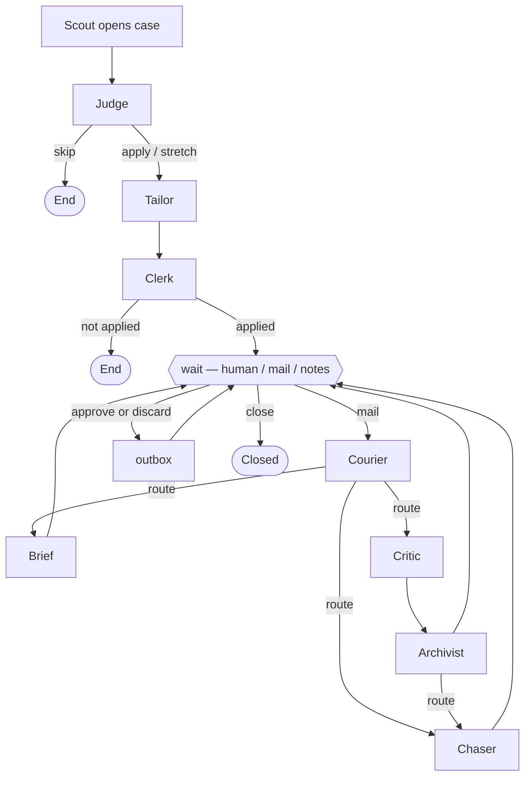
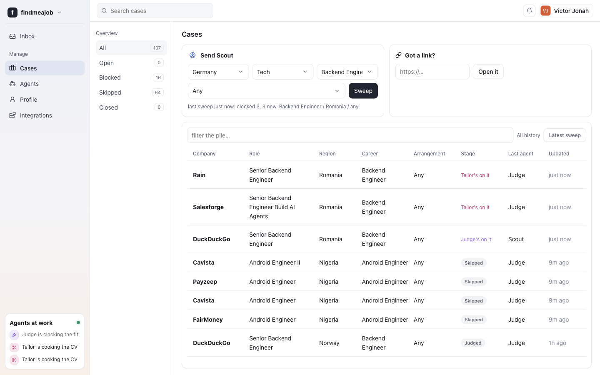
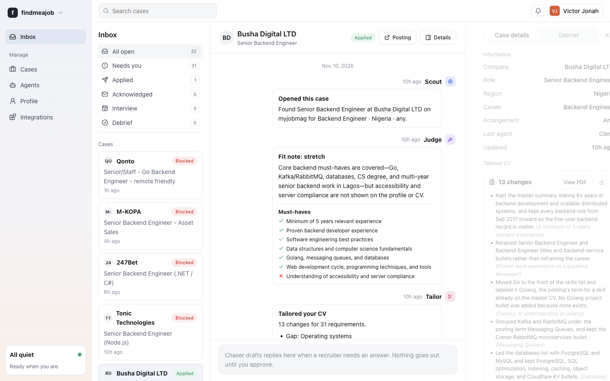
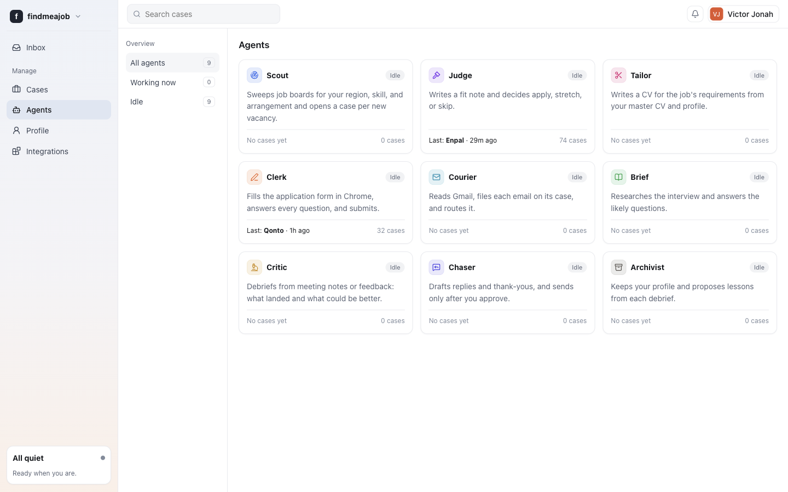
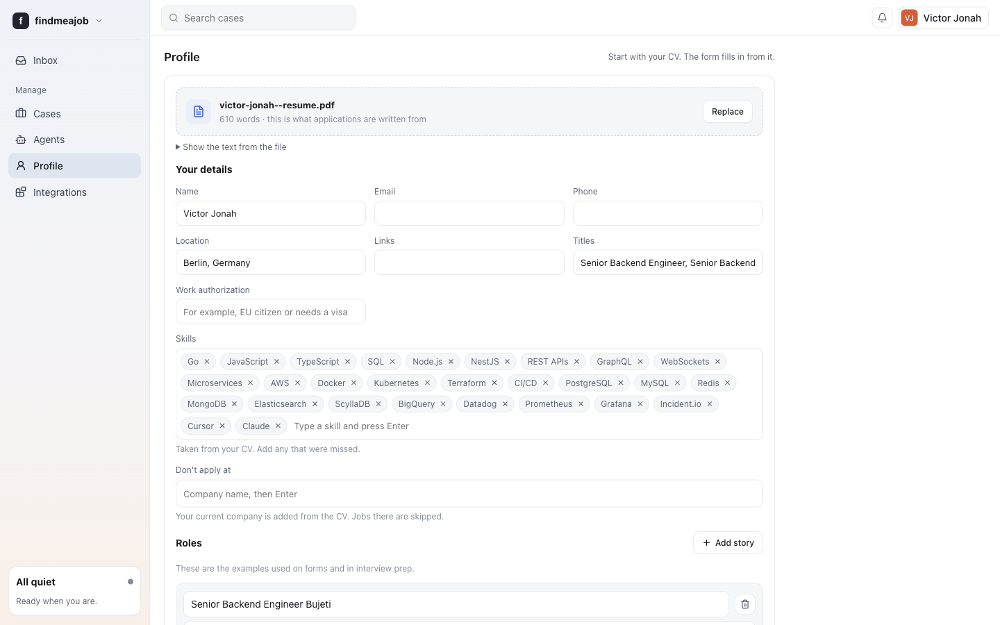
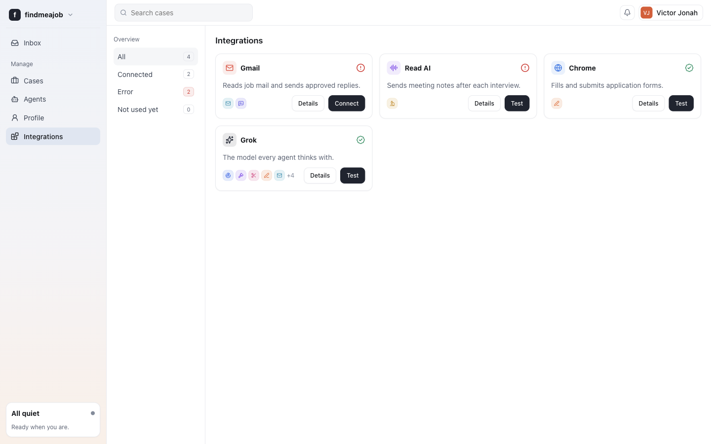

# findmeajob

[](https://github.com/Vectormike/findmeajob/actions/workflows/ci.yml)

**findmeajob** is a multi-agent job search workflow I built to explore applied LLM systems end to end: Scout sweeps public boards and employer sites, a LangGraph case graph runs Judge → Tailor → Clerk on each posting, and human-in-the-loop gates pause for Gmail traffic, interview notes, captcha handoffs, and Chaser drafts before anything is sent. A SvelteKit dashboard (served by FastAPI) is the control plane—filters, inbox, approvals, and per-agent retries. Grok (xAI) powers structured agent calls; Playwright drives real application forms when Clerk applies.

<!-- Demo video: paste a link here when you record a walkthrough -->

## Architecture

Scout lives **outside** the LangGraph graph: it searches job sources, deduplicates listings, and calls `Workflow.start()` for each new case. The graph then owns one **case** from first read through debrief.

| Agent | Role |
| --- | --- |
| **Scout** | Sweeps boards for region, skill, and arrangement; opens a case per new vacancy |
| **Judge** | Fit note: apply, stretch, or skip (ends early on skip) |
| **Tailor** | Job-specific CV from your master CV and profile |
| **Clerk** | Fills and submits the application in Chrome (may pause for captcha) |
| **Courier** | Polls Gmail, files mail on the right case, routes follow-ups |
| **Brief** | Interview prep from research on the company and role |
| **Critic** | Debrief from Read AI meeting notes or feedback |
| **Chaser** | Drafts replies and thank-yous |
| **Archivist** | Proposes profile lessons after a debrief |

After Clerk marks a case **applied**, the graph hits a **`wait`** node implemented with LangGraph **`interrupt`**. The case resumes only when you (or integrations) send an event—new mail, meeting notes, approve/discard on Chaser’s draft, or close. Approved Chaser drafts go through **outbox**, which sends via Gmail.



**Human-in-the-loop** (via dashboard APIs): approve or edit Chaser drafts before send; discard drafts; solve Clerk captchas in a live browser handoff; assign unmatched mail to a case; retry or re-run specific agents on a stuck case; accept or dismiss Archivist memory suggestions.

Persistence: **PostgreSQL** stores LangGraph checkpoint and store data in `dev` / `prod` (`APP_ENV=test` uses in-memory storage for tests).

## Prerequisites

- **[uv](https://docs.astral.sh/uv/)** — Python deps and `uv run …`
- **Python 3.12** — see `.python-version`
- **Node.js 24** — see `frontend/.nvmrc`
- **Docker** — Postgres via `docker compose` (local dev and production-like runs)
- **Google Chrome** — Clerk and browser tests use Playwright’s Chrome channel (`channel="chrome"`). After install: `uv run playwright install-deps chrome` on Linux if system libraries are missing
- Optional: Gmail OAuth client files, Read AI webhook, xAI API key, The Muse API key (Scout only)

## Environment variables

Copy `.env.example` to `.env` (git-ignored):

| Variable | Purpose |
| --- | --- |
| `APP_ENV` | `dev`, `test`, or `prod`. Non-`test` uses Postgres from `DATABASE_URL` |
| `DATABASE_URL` | Postgres connection string (default matches `docker-compose.yml`) |
| `XAI_API_KEY` | xAI API key for Grok; without it agents cannot call the model |
| `XAI_MODEL` | Grok model id (default `grok-4.7`) |
| `GMAIL_CREDENTIALS_FILE` | OAuth client JSON for `findmeajob gmail-auth` |
| `GMAIL_TOKEN_FILE` | Saved user token; Courier and outbox need this |
| `COURIER_POLL_SECONDS` | How often Courier polls Gmail when the server runs |
| `READAI_WEBHOOK_SECRET` | Secret segment in `/webhooks/readai/<secret>` for meeting notes |
| `CHROME_PROFILE_DIR` | Persistent Chrome user data for Clerk |
| `CHROME_HEADLESS` | Run Clerk’s browser headless when `true` |
| `DATA_DIR` | On-disk case artifacts (e.g. tailored CV PDFs) |
| `SCOUT_MAX_CASES` | Cap on new cases per Scout sweep from the UI/CLI |

`THE_MUSE_API_KEY` (optional, in settings only) feeds The Muse source when set.

## Quickstart

```bash
docker compose up -d
cp .env.example .env
# Add XAI_API_KEY to .env before running agents that call the model

cd frontend && npm install && npm run build && cd ..
uv sync
uv run findmeajob serve
```

Open [http://127.0.0.1:8000](http://127.0.0.1:8000). Upload a CV on **Profile**, set filters on **Cases**, and run a sweep. Use **Inbox** for thread detail, captcha handoff, and draft approval.

CLI one-shot sweep (same Postgres-backed workflow as the server):

```bash
uv run findmeajob scout <region> "<skill>" --arrangement remote
```

Connect Gmail (optional):

```bash
uv run findmeajob gmail-auth
```

## Running tests

```bash
uv sync --group dev
uv run pytest -q
```

```bash
cd frontend && npm ci && npm run check && npm run build
```

The pytest suite uses **fakes** (`tests/fakes.py`) for the LLM, Gmail, Chrome, and HTTP fetches—no live API keys. Storage is **in-memory** (`APP_ENV=test`); **Postgres is not required in CI**. `tests/test_browser.py` exercises Playwright form automation against inline HTML with the **Chrome** channel; CI installs Chrome and Playwright’s system deps.

## Dashboard

### Cases

Pick region, career, and arrangement, then sweep. Scout lists jobs with Judge’s verdict, location, and posting age.



### Inbox

Per-case thread: Scout → Judge → Tailor → Clerk, then mail and debrief as the case progresses.



### Agents



### Profile

CV upload seeds the profile every agent reads.



### Integrations

Gmail, Read AI, Chrome, and Grok connection status.



## Security

The local API has **no authentication**. It is intended for **localhost** use (`findmeajob serve` defaults to `127.0.0.1`). Do not expose it to the public internet without adding your own auth and TLS. Keep `.env`, Gmail secrets, and webhook secrets out of version control.

## Responsible use

Scout reads **public job APIs and HTML** from listed sources (see `src/findmeajob/tools/jobs/`). Respect each site’s terms, rate limits, and robots rules; this project is for **personal** job search, not bulk scraping or resale of listings. **Clerk** can submit applications in a real browser—use only on roles you intend to pursue, review Tailor’s CV before apply when possible, and comply with employer and board policies on automation and truthful applications.

## License

[MIT](LICENSE)
